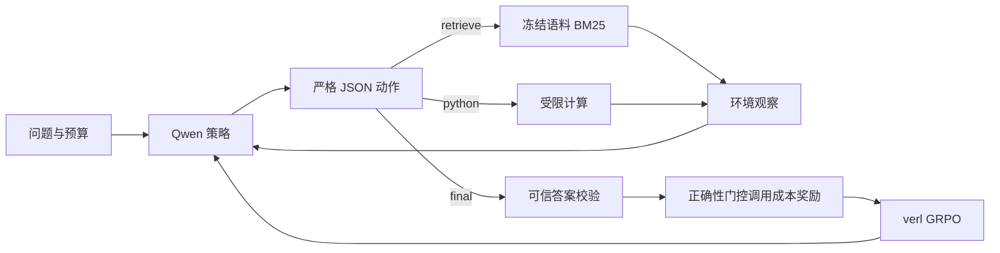

# Tool-R1 实施方案：单卡 A6000

## 研究问题与范围

从 Search-R1 的“推理中选择搜索”扩展为“推理中选择检索、计算或结束”。第一阶段保留两个互补工具：BM25 提供题目中没有的事实，Python 执行确定性计算。Calculator 与 Python 功能重叠，在线搜索还会引入不稳定内容与费用，所以当前实现以可冻结的本地语料和受限计算为基准。

假设 H1：GRPO 相比同一 SFT 初始化提升任务正确率。H2：加入调用成本后，在预设正确率约束内降低平均调用数。H3：显式预算条件化帮助模型适应未见预算。这些是假设，必须分别由 M3/M2、M4/M3、M4/M5 的实验检验。

## 系统结构



模型逐轮输出一个动作对象，不要求显式输出长篇内部推理。模型生成 token 才参与策略损失；环境观察、角色分隔及下一轮助手前缀保留为上下文，mask 为零。SFT 同样只监督当前助手动作。

## 环境与动作

```json
{"action":"tool","name":"retrieve","arguments":{"query":"NOVA-... audited actual 2024","top_k":3}}
{"action":"tool","name":"python","arguments":{"code":"print(round(100*(140-100)/100, 4))"}}
{"action":"final","answer":{"type":"number","value":40,"unit":"percent"}}
```

每次非 final 尝试消耗一个可用额度，包括格式错误、未知工具、参数错误和运行失败。这样不能通过无效调用绕开成本。额度耗尽后允许一次拒绝反馈，并要求下一轮 final；再次请求会终止。final 免费，可在零工具调用时提交。

环境角色是 user JSON，模型不能通过在自己的文本中伪造 observation 让执行器信任它。受限 Python 解释 AST，不执行宿主 `eval/exec`；允许数值、容器、循环、推导式和少量计算函数，禁止导入、属性访问、文件与网络。另有可选 Docker 后端，容器无网络、只读、非 root、限制 CPU/内存/进程/输出和时间，要求提前拉取指定镜像。

## 奖励

设 V 为执行校验得到的答案正确性，C 为 admitted_calls，固定参考上限 6：

`R = V × (1 − λ C / 6)`，M3 使用 λ=0，M4/M5 使用 λ=0.1。

错误答案奖励为 0，正确答案奖励至少 0.9，不给“调用了工具”本身正奖励。无效/失败尝试计入调用成本。长度、无效请求率、执行失败率单独监控，避免第一版引入多个容易相互抵消的奖励项。短输出由硬 token 限制约束。

GRPO 组内标准差归一化会改变 λ 的实际影响：当一组全部答对但成本不同，缩小 λ 可能被归一化抵消。因此 0.1 不是严格的更新强度上限；必须观察正确率与调用数，并保留 M3 对照。全部同奖励的组不能提供有效相对奖励学习信号。

## 训练方案

1. 审计数据与执行教师回放，构建 4800 个单轮 SFT 目标。
2. Qwen2.5-3B-Instruct 做 rank=32 的 LoRA SFT，默认一轮。
3. 合并 SFT adapter，固定模型文件哈希，作为三组 RL 的共同基础模型。
4. verl v0.7.0 固定 Git commit，单 GPU FSDP + LoRA，异步 vLLM rollout。
5. M3/M4/M5 各默认 500 次更新，group=4，batch=8，context=4096，梯度检查点、CPU offload、SDPA。
6. 导出最后完成的 checkpoint。默认不利用测试集选优；若改用验证选优，所有方法必须同样执行并记录规则。

SFT 合并后，禁用 RL LoRA adapter 所得到的 KL reference 对应 SFT 策略。这个步骤避免把 KL 参考误设为未训练基础模型。固定上游提交与对应配置已做静态 API 核对；实际 GPU 行为仍须容量测试。

## 评测与统计

训练预算 2/4，完整评测预算 1/2/3/4/6。M5 移除系统提示与观察中的显式剩余额度，但仍受相同资源限制。它可从自身调用历史和拒绝事件推断预算；消融结论应限定为“显式预算输入”。

主要指标：答案正确率、全体平均 admitted_calls、正确题平均调用、direct 任务不必要调用比例、无效请求率、执行失败率、预算违规轨迹率和生成 token。无分母或未测量指标显示 N/A。

M4 对 M3 采用严格同题同预算配对，按任务分层、按题聚类 bootstrap，保留同题不同预算的相关性。默认 2000 次重采样、95% 区间。只有正确率差下界 ≥ −2 个百分点且调用差上界 <0，才支持效率改善；这不是跨训练种子稳定性的证据。

所有原始轨迹附带评分、工具计数、停止原因和系统/模型消息。评测清单绑定数据、代码、协议、解码、模型以及训练来源；文件变动或配置不一致会阻止受控比较。M0 单独报告，不能与有工具预算的模型直接作同预算效率比较。

## 计算资源与缩减顺序

3B BF16 基础参数约 6GB，训练与推理服务会有不同副本，还需激活、KV cache、LoRA 梯度、优化器及框架缓存，因此不能用参数体积代替峰值显存。48GB A6000 是本方案合理起点，仍需实测；32GiB 内存只是启动检查下限，建议 64GiB+，完整实验建议 150GiB+ 空闲磁盘。

出现 OOM 时先降低并发序列和 batch，随后减少上下文或改为 1.5B。改变模型或重要训练参数必须重做全部主对照。短期资源有限时先完成 M1–M4、预算 2/4，再扩展 M5 和预算泛化。不要把未完成实验写成收益。

## 验收与可展示成果

工程验收：可重建数据、真实工具执行、可信奖励、正确 mask、SFT/GRPO/导出入口、同预算评测、配置和权重溯源、测试与运行手册。

研究验收：A6000 容量测试通过，取得 M1–M4 主对照和原始结果，按正确率约束解释成本变化；扩展验收增加 M5、未见预算、三个训练种子与真实领域数据。目前只完成本地工程验证，服务器实验仍待执行。

简历描述应按实际阶段使用。未训练前可描述实现的环境、训练接口和评测体系；只有完成实测后才填写正确率、成本降幅、训练时长及泛化结论。

参考：[Search-R1](https://github.com/Shicheng-Liu/Search-R1)、[verl 固定提交](https://github.com/verl-project/verl/tree/f9c855f7cf04d603c9546bc01776c74806a879c1)、[Qwen2.5-3B-Instruct](https://huggingface.co/Qwen/Qwen2.5-3B-Instruct)。本项目使用独立实现的工具环境，通过 verl AgentLoop 接入训练，并非完整复现 Search-R1 论文实验。
